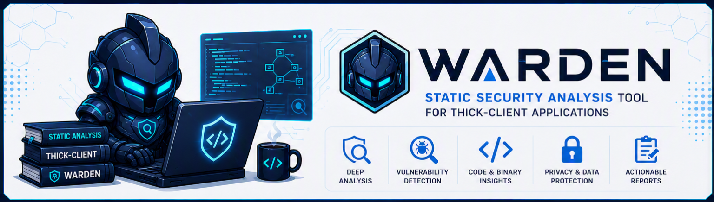

<div align="center">

# 🛡️ Warden

### Static security analysis for thick-client desktop applications

*Catch the findings a manual reverse-engineer would — unsigned binaries, trust-all TLS,
insecure deserialization, weak crypto, DLL hijacking, leaked secrets — **without running the target.***

[](https://github.com/Ankesh-Prajapati/Warden/releases/latest)
[](https://www.python.org/)
[](#)
[](#-what-warden-is-and-isnt)
[](#)

<samp>**[⬇ Download EXE](https://github.com/Ankesh-Prajapati/Warden/releases/latest)** · [Highlights](#-highlights) · [What it catches](#-what-it-catches) · [Quick start](#-quick-start) · [Reports](#-reports) · [⚠ Authorized use only](#️-authorized-use-only)</samp>

</div>

---

## 🚀 Highlights

<table>
<tr>
<td width="33%" valign="top">

### 🧊 Opens real installers
Unpacks **NSIS, Inno Setup, MSI, Electron (`app.asar`), 7z/ZIP/CAB** — and even a plain PE carrying a nested archive — then scans the **actual application**, not just the wrapper.

</td>
<td width="33%" valign="top">

### 🔬 Reads the bytecode
Goes past strings: parses **.NET metadata + IL** (`dnfile`) and **Java `.class`/`.jar`** to prove real API usage — trust-all TLS, insecure deserialization, weak crypto.

</td>
<td width="33%" valign="top">

### 📑 Report you can hand over
A clean, filterable **HTML/JSON report** — executive summary, findings index, evidence, remediation, copy-paste PoC, and a print-to-PDF layout. Noise lives in a separate appendix.

</td>
</tr>
</table>

> **Static-only by design.** Warden reads and parses — it never executes the target, hooks processes, or exploits anything. It automates the *static* half of a thick-client assessment so your manual time goes to the dynamic and business-logic work.

---

## 🎯 What it catches

<div align="center"><em>Technology-aware deep checks — the findings a manual review in dnSpy / CFR / CFF Explorer would surface, automated.</em></div>

| Surface | Representative findings |
|---|---|
| 🪟 **Windows PE** | Unsigned / tampered / expired signing · ASLR · DEP · CFG · SafeSEH · packers · PDB & build-path leaks · embedded manifest / privilege level |
| 🧩 **DLL hijacking** | Phantom imports · unsafe search-order · writable binary dirs · unquoted service paths — each with a reproduction PoC |
| 🟣 **.NET** *(metadata + IL)* | Insecure deserialization (`BinaryFormatter`, `SoapFormatter`, `LosFormatter`, `JavaScriptSerializer`+resolver, Remoting) · weak crypto (DES/RC2/3DES/MD5) · **TLS validation disabled** · weak TLS protocol pinned |
| ☕ **Java** *(bytecode)* | Trust-all `TrustManager` / `HostnameVerifier` · weak cipher (DES/RC4/ECB) · weak hash (MD5/SHA-1) · `ObjectInputStream` deserialization · hardcoded JDBC credentials |
| ⚛️ **Electron** | Runtime fuses (RunAsNode, NODE_OPTIONS, `--inspect`, ASAR integrity) · ASAR integrity on an unsigned EXE · risky `webPreferences` · missing navigation guards · outdated Chromium |
| 🔑 **Secrets & config** | API keys/tokens · JWTs (decoded) · DB connection strings · correlated secret bundles · high-entropy candidates · JSON/XML/YAML/INI/TOML/SQLite/plist settings |
| 🐧 **Linux** | ELF hardening (PIE/NX/RELRO/canary/RPATH) · SUID/SGID · unsafe systemd `ExecStart` · AppImage/Flatpak/Snap metadata |
| 🍎 **macOS** | Mach-O signing · hardened runtime · notarization · risky entitlements · unsafe URL schemes · quarantine-bypass risk |
| 🧰 **Installers** | Outdated NSIS runtime (CVE-2023-37378) · non-production API endpoints baked into release builds · Inno Setup payload unpacking |
| 🧪 **Reputation** | *Opt-in* VirusTotal SHA-256 lookup (hash only unless you explicitly enable upload) |

---

## 📦 Install

### Option A — Standalone Windows app *(no Python)*
**[⬇ Download `Warden.exe`](https://github.com/Ankesh-Prajapati/Warden/releases/latest)** and double-click. That's it — one file, no console window.
*Install [7-Zip](https://www.7-zip.org/) for installer/archive extraction; [innoextract](https://constexpr.org/innoextract/) if you assess Inno Setup installers.*

### Option B — From source *(Python 3.10+)*

```bash
git clone https://github.com/Ankesh-Prajapati/Warden.git && cd Warden
python -m venv venv && source venv/bin/activate      # Windows: venv\Scripts\activate
pip install -r requirements.txt
```

<details>
<summary><b>Optional external tools</b> (each degrades gracefully if missing)</summary>

| Tool | Gives you |
|---|---|
| `7z` (7-Zip / p7zip) | Installer & archive extraction |
| `innoextract` | Unpacking Inno Setup installer payloads |
| `dnfile` *(pip, bundled in the EXE)* | .NET metadata + IL checks |
| `osslsigncode` | Authenticode digest verification on Linux/macOS *(Windows uses the built-in `WinVerifyTrust`)* |
| `readelf` | Deeper ELF analysis on Linux |
| `otool`, `codesign`, `spctl` | Deeper Mach-O / notarization analysis on macOS |
| `yara-python` | Custom YARA scans |

</details>

---

## ⚡ Quick start

**Desktop app**
```bash
python desktop/main.py          # or just run Warden.exe
```

**CLI**
```bash
# Full Windows pass → self-contained HTML + raw JSON
python cli.py scan ./target \
  --module secrets --module dll_hijack --module signature --module re_exposure \
  --output report.html --json findings.json

# Single binary, quick look
python cli.py scan app.exe --output report.html
```

<details>
<summary><b>All CLI options</b></summary>

| Option | Description |
|---|---|
| `--output, -o PATH` | HTML report output path |
| `--json PATH` | Also write raw JSON findings |
| `--module NAME` | Repeatable: `secrets`, `dll_hijack`, `signature`, `re_exposure`, `linux`, `macos`, `reputation` |
| `--rules-dir PATH` | Override YAML secret-rule directory |
| `--no-entropy` | Disable entropy-based secret detection |
| `--no-pe-strings` | Skip embedded PE string scanning |
| `--services-file PATH` | `sc query` / `wmic service` text for unquoted-service-path checks |
| `--no-osslsigncode` | Skip `osslsigncode` verification |
| `--vt-api-key KEY` | VirusTotal API key (or `VT_API_KEY`) |
| `--vt-include-clean` / `--vt-max-lookups N` / `--vt-upload-unknown` | VirusTotal tuning (upload is off by default) |
| `--incremental` / `--cache-file PATH` | SHA-256 incremental scan cache |
| `--yara-rules-dir PATH` | Custom YARA rules folder |
| `--plugins-dir PATH` | Trusted Python detector plugins exposing `scan_file(path)` |
| `--max-workers N` | Worker count for supported scans |
| `--hide-inventory` | Hide inventory/pass findings |
| `--no-extract-archives` | Skip installer/archive extraction (on by default) |
| `--archive-max-depth N` | Max nesting depth for archives-in-archives (default `2`) |
| `--archive-max-size-mb N` | Cap on total extracted content per archive (default `2048`) |

</details>

---

## 🧊 Archive & installer extraction

On by default. Before scanning, Warden unpacks installer/archive-looking files — **NSIS, Inno Setup, MSI, Electron `app.asar`, self-extracting installers, ZIP/CAB/7z**, and even a plain PE carrying a nested archive in its resources — then recursively scans the extracted contents.

Why it matters: a real Electron installer isn't the app. Warden opens `app-64.7z → app.asar → the renderer bundle`, an NSIS setup down to its plugin DLLs, and an Inno Setup installer via `innoextract`. Findings from extracted content are tagged `extracted-content` and note their origin. Bounded by nesting depth, a total-size cap (zip-bomb protection, checked *before* writing), and a per-archive candidate cap. Missing a tool is never fatal — the outer file is still scanned, with a note.

---

## 📑 Reports

Self-contained, single-file **HTML** (plus optional **JSON**) you can send to a client or diff in CI:

- **Executive summary** with risk rating and severity distribution
- **Findings index** (`W-001…`) → filter by severity / area / full-text search
- Per-finding **evidence, affected locations, remediation, and copy-paste PoC**
- **Reverse-engineering inventory appendix** — endpoints, dependencies, frameworks, and *verified hardening controls* kept out of the findings count
- **Print → PDF** layout; light & dark themes; renders cleanly from 0 to hundreds of findings

> Reports contain complete extracted evidence (possibly credentials, tokens, proprietary indicators). Warden never transmits them — keep them local and share only with authorization. Desktop reports land in `reports/<AppName>/<AppName>_report_<timestamp>.html` next to the app (falling back to `~/.warden/reports` when the install folder is read-only).

<details>
<summary><b>Custom rules & plugins</b></summary>

- **Secret rules** — YAML under `rules/`.
- **YARA** — `rules/yara/` or `--yara-rules-dir ./my-yara`.
- **Python detectors** — `--plugins-dir ./plugins`, each exposing `def scan_file(path): return []`.
  *Plugins run as trusted code and are not sandboxed — only point Warden at folders you trust.*

</details>

<details>
<summary><b>Project structure</b></summary>

```text
Warden/
  core/            # scanner + modules (secrets, dll_hijack, signature, re_exposure,
                   #   dotnet_checks, java_checks, electron_checks, linux, macos,
                   #   reputation, archive_extractor, finding_grouping, pe_utils …)
  desktop/         # PySide6 app (main_window, scan_worker, finding_dialog, settings, theme)
  report/          # html_export.py
  rules/           # secrets_patterns.yaml, system_dlls.yaml, packer_signatures.yaml, components.yaml
  tests/           # test_fixes.py (+ fixtures: .NET / Java vulnerable & safe samples)
  cli.py · warden.spec · requirements.txt
```
Both interfaces call `core.scanner.run_scan()`; module output is normalized into `core.models.Finding` and rendered by `report.html_export`.
</details>

---

## 🧭 What Warden is — and isn't

| ✅ Warden does (static) | ❌ Warden does not (dynamic / manual) |
|---|---|
| Parse PE/ELF/Mach-O, .NET IL, Java bytecode | Run, debug, or hook the target |
| Unpack installers & scan the real app | Exploit, bypass, or prove exploitability |
| Flag unsigned/weak-crypto/trust-all/secrets | Intercept live traffic / MITM |
| Produce a shareable report with PoC steps | Memory/registry diffing, fuzzing, business logic |

It's the **static client-side pass** of a thick-client engagement — fast, repeatable, low-noise — leaving the runtime and logic work to you.

<details>
<summary><b>Known limitations</b></summary>

- Static-only: it does not prove exploitability.
- Entropy findings are heuristic and can false-positive.
- VirusTotal hash lookup is reputation data, not a verdict.
- Python plugins are trusted code, not sandboxed.
- Full Authenticode trust/revocation is best confirmed with Windows `signtool verify /pa`.
- Some Linux/macOS checks need the platform's native tools present.
- Encrypted SQLite (SQLCipher) can't be inspected.
- `--incremental` restores cached findings for unchanged files; delete `.warden_cache/` after upgrading rule packs.

</details>

<details>
<summary><b>Build & test</b></summary>

```bash
python -m pytest -q tests                 # regression suite
pyinstaller --noconfirm warden.spec       # → dist/Warden.exe (one file, no console)
```
Keep `build/`, `dist/`, `__pycache__/`, `.pytest_cache/`, `.warden_cache/`, venvs, and generated reports out of source control.
</details>

---

## ⚠️ Authorized use only

> [!CAUTION]
> **Warden is for authorized security assessments only.**
>
> Use it **exclusively** against applications you **own** or have **explicit written permission** to assess. Scanning, reverse-engineering, or extracting software without authorization may violate computer-misuse law, software license terms, and NDAs.
>
> You are solely responsible for how you use this tool. The author accepts **no liability** for misuse or for any damage arising from its use. Reports can contain sensitive client data — handle, store, and share them only within the bounds of your engagement.
>
> **No authorization? Don't scan it.**

---

<div align="center">

Built & maintained by **[Ankesh Prajapati](https://github.com/Ankesh-Prajapati)**
🛡️ *Static analysis for people who do the dynamic work themselves.*

</div>
